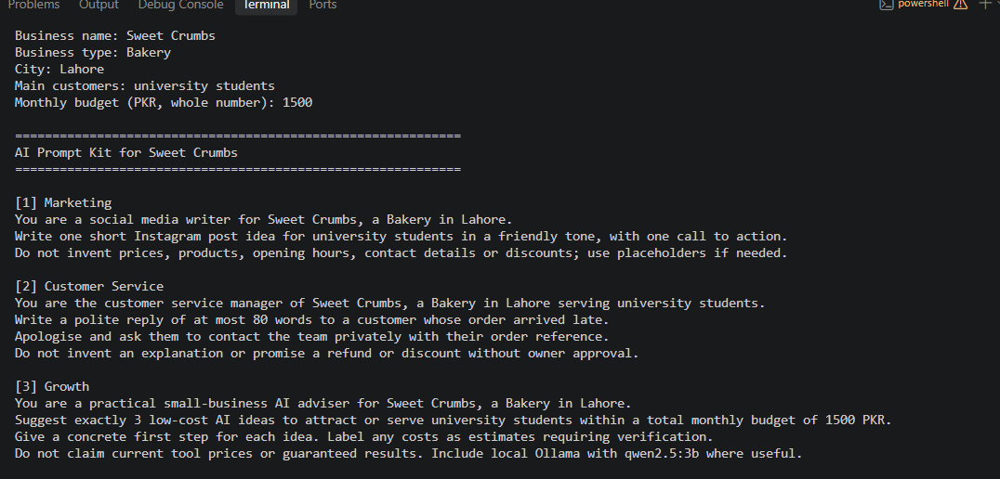
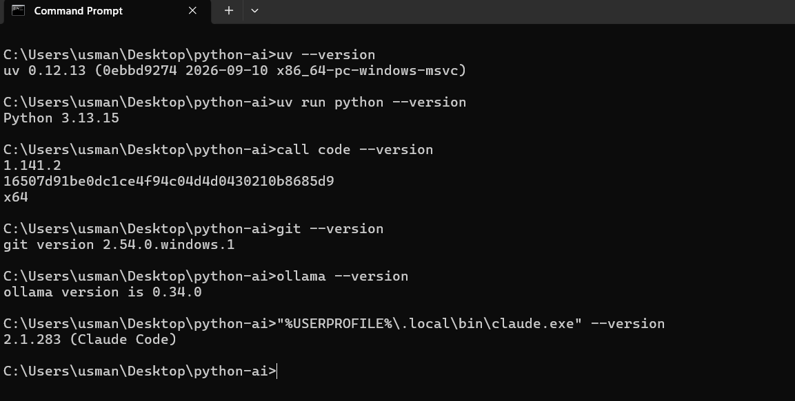

# Python for AI — Muhammad Usman Safdar

Learning portfolio for **Python for AI**, following [the School of AI course](https://github.com/the-schoolofai/python-ai).

**Goal:** Become an AI Agent Developer who builds useful tools for small businesses.
**Local model:** `qwen2.5:3b` through Ollama.

## Read → Quick Check → Code Task

Start with the [lesson and assignment index](docs/README.md). Course readings are in `docs/course/`; my scripts are in `code/`. Record your own answers in [my-answers-module-1.md](docs/my-answers-module-1.md).

## Run

Install uv and use Python 3.13. From the project folder:

```powershell
uv sync
uv run main.py
uv run code/lesson_01_intro.py
uv run code/lesson_02_toolkit.py
uv run code/lesson_04_print_input.py
uv run code/lesson_05_variables.py
uv run code/lesson_06_strings_prompts.py
```

For number questions, enter whole numbers without commas, e.g. `15000`. Invalid numeric text raises ValueError; these scripts deliberately use the beginner concepts taught so far.

| Lesson | Implemented work |
|---|---|
| 1.1 | Career introduction and business problem |
| 1.2 | Actual toolkit versions and first Ollama conversation |
| 1.3 | Simple uv project, lockfile, clean folders and README |
| 1.4 | Business prompt builder and budget stretch |
| 1.5 | Model profile, data types and monthly practice cost estimate |
| 1.6 | Prompt cleaner, 150-character limit and formatting |

## Module 1 Project: AI Prompt Kit

A Python tool that turns five business details into marketing, customer service and growth prompts, with a bonus WhatsApp enquiry prompt.

**Run:** `uv run code/project_m1_prompt_kit.py`

**Who would pay for this:** Small business owners who need help drafting specific AI prompts for marketing and customer service.

The selected business is **Crumble Pakistan**, a cookie bakery, with Lahore as the case-study location. The student/family audience and 15000 PKR monthly budget are assignment assumptions. This is independent student work without company involvement.

- [Business profile and sources](docs/crumble-business-profile.md)
- [Actual Qwen answers and evaluations](docs/project-m1-results.md)
- [Actual Crumble run transcript](docs/project-m1-run.txt)
- [Three-minute demo and code explanations](docs/module-1-study-guide.md)



The genuine student-supplied screenshot predates the switch to Crumble and shows the earlier example with 1500 PKR. It remains evidence of the script running; the current Crumble inputs and output are in the transcript above. A matching Crumble screenshot would make the presentation more consistent.

## Setup and verification



See [toolkit checks](docs/setup-check.md), [first Ollama chat](docs/ollama-first-chat.md), [script verification](docs/verification.md) and [model notes](docs/model-notes.md).

## Submission status

See the [requirement-by-requirement audit](docs/submission-checklist.md). Scripts and AI tests are present; the student's own Quick Check attempts, lesson reading and live demo cannot be certified by repository files. AI-assisted [reference answers](docs/module-1-reference-answers.md) are separate study material. Understand every line before presenting.

The 0.50 PKR token rate in the exercises is fictional practice pricing, not Ollama billing. Commit history records actual work; keep making new commits and pushes as you learn.
