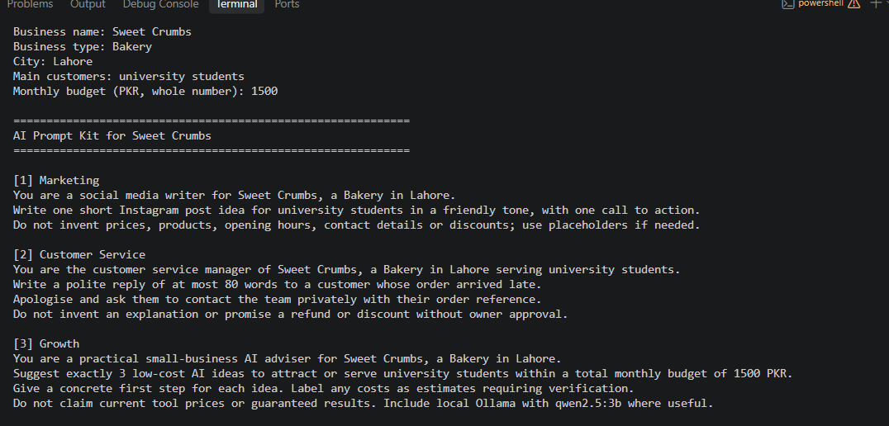
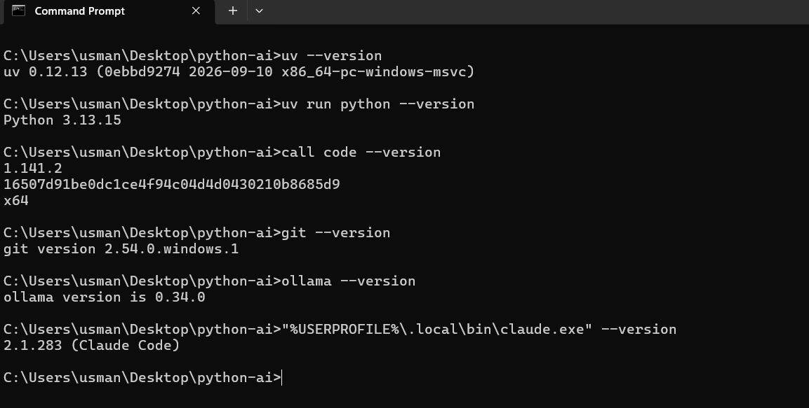

# Python for AI — Muhammad Usman Safdar

Learning portfolio for **Python for AI**, following [the School of AI course](https://github.com/the-schoolofai/python-ai).

**Goal:** Become an AI Agent Developer who builds useful tools for small businesses.
**Local model:** `qwen2.5:3b` through Ollama.

## Read → Quick Check → Code Task

Start with the [lesson and assignment index](docs/README.md). Course readings are in `docs/course/`; my scripts are in `code/`. Completed [AI-assisted Quick Check answers](docs/my-answers-module-1.md) include the module quiz and all six lesson short checks.

## Run

Install uv and use Python 3.13. From the project folder:

```powershell
uv sync
uv run main.py
uv run code/lesson_01_intro.py
uv run code/lesson_02_toolkit.py
uv run code/lesson_04_print_input.py
uv run code/lesson_05_variables.py
uv run code/lesson_06_strings_prompts.py
```

For number questions, enter whole numbers without commas, e.g. `15000`. Invalid numeric text raises ValueError; these scripts deliberately use the beginner concepts taught so far.

| Lesson | Implemented work |
|---|---|
| 1.1 | Career introduction and business problem |
| 1.2 | Actual toolkit versions and first Ollama conversation |
| 1.3 | Simple uv project, lockfile, clean folders and README |
| 1.4 | Business prompt builder and budget stretch |
| 1.5 | Model profile, data types and monthly practice cost estimate |
| 1.6 | Prompt cleaner, 150-character limit and formatting |

## Module 2: Core Python for Building LLM Apps

The eight lesson tasks and both checkpoint project scripts are implemented. See the [Module 2 submission checklist](docs/module-2-submission-checklist.md), [roadmap](docs/module-2-roadmap.md), [AI-assisted quick-check reference answers](docs/my-answers-module-2.md), [Checkpoint 1 design and results](docs/project-m2-cp1-design.md), and [final project design and results](docs/project-m2-final-design.md). Live outputs exposed model hallucinations in creative copy; see the result files before treating generated text as publishable.

The project uses `qwen2.5:3b` through local Ollama. Install the dependencies with `uv sync`, start Ollama, and ensure the model is available (`ollama pull qwen2.5:3b` if needed).

**Run the lessons from the project root:**

```powershell
uv run code/lesson_2_1_first_ai_call.py
uv run code/lesson_2_2_chat_memory.py
uv run code/lesson_2_3_persona_bot.py
uv run code/lesson_2_4_batch_writer.py
uv run code/lesson_2_5_ai_skills.py
```

Tasks 2.6, 2.7, and the final assistant use data files relative to `code/`, so run those from that folder:

```powershell
cd code
uv run lesson_2_6_saved_bot.py
uv run lesson_2_7_extractor.py
uv run project_m2_content_studio.py
uv run lesson_2_8_first_agent.py
uv run project_m2_business_assistant.py
```

**Checkpoint 1 project — AI Content Studio:** `code/project_m2_content_studio.py` writes menu drafts, streams social posts, answers prices directly from the demo dictionary, and chats with bounded memory. Feature tests and a real-model evaluation are in `docs/project-m2-cp1-design.md` and `docs/project-m2-cp1-results.md`; console excerpts are in [the run transcript](docs/project-m2-cp1-run.txt).

This can save an owner time drafting a menu and social post in one session. They would pay for a checked workflow that keeps prices tied to supplied data; AI-written descriptions still need review.

**Checkpoint 2 final project — AI Business Assistant:** `code/project_m2_business_assistant.py` reads `code/business.json`, uses tools for facts and order status, requires owner approval before saving orders, validates WhatsApp order imports, and saves private state. Its tool inventory, guardrails, and run results are in `docs/project-m2-final-design.md` and `docs/project-m2-final-results.md`; console excerpts are in [the run transcript](docs/project-m2-final-run.txt).

| Tool | Purpose |
|---|---|
| `get_price` | Reads a listed item price from the business JSON |
| `get_info` | Reads hours, delivery, or another supplied fact |
| `order_status` | Checks an order saved in the local order file |
| `place_order` | Calculates a total and saves only after owner approval |

This can save staff time checking common questions and copying order details. An owner would pay for the checked intake and approval workflow, with business facts maintained by the owner.

The professor-required PNG screenshots have not been captured. The Windows computer-use skill forbids automating terminal applications, so the repo includes real console transcript excerpts instead; screenshots still need to be captured from the student's terminal.

## Module 1 Project: AI Prompt Kit

A Python tool that turns five business details into marketing, customer service and growth prompts, with a bonus WhatsApp enquiry prompt.

**Run:** `uv run code/project_m1_prompt_kit.py`

**Who would pay for this:** Small business owners who need help drafting specific AI prompts for marketing and customer service.

The selected business is **Crumble Pakistan**, a cookie bakery, with Lahore as the case-study location. The student/family audience and 15000 PKR monthly budget are assignment assumptions. This is independent student work without company involvement.

- [Business profile and sources](docs/crumble-business-profile.md)
- [Actual Qwen answers and evaluations](docs/project-m1-results.md)
- [Actual Crumble run transcript](docs/project-m1-run.txt)
- [Three-minute demo and code explanations](docs/module-1-study-guide.md)



The genuine student-supplied screenshot predates the switch to Crumble and shows the earlier example with 1500 PKR. It remains evidence of the script running; the current Crumble inputs and output are in the transcript above. A matching Crumble screenshot would make the presentation more consistent.

## Setup and verification



See [toolkit checks](docs/setup-check.md), [first Ollama chat](docs/ollama-first-chat.md), [script verification](docs/verification.md) and [model notes](docs/model-notes.md).

## Submission status

See the [requirement-by-requirement audit](docs/submission-checklist.md). Scripts and AI tests are present; the student's own Quick Check attempts, lesson reading and live demo cannot be certified by repository files. AI-assisted [reference answers](docs/module-1-reference-answers.md) are separate study material. Understand every line before presenting.

The 0.50 PKR token rate in the exercises is fictional practice pricing, not Ollama billing. Commit history records actual work; keep making new commits and pushes as you learn.

## Commit messages

Use the professor's exact messages for the named submissions:

```text
Python for AI
Module 1 quick checks
Module 1 Project: AI Prompt Kit
```

For individual tasks and later task fixes, use `Task <lesson>: <clear description>`, for example `Task 1.1: intro script`. Existing task commits follow this format; the project and Quick Check commits use their prescribed exact messages. Other earlier maintenance commits retain their descriptive messages and original dates.
